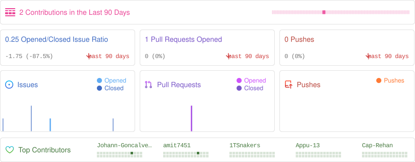
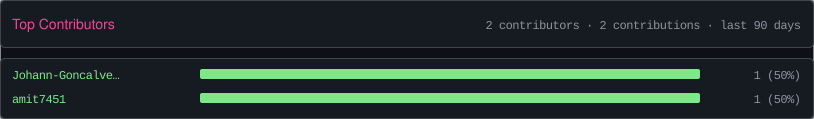
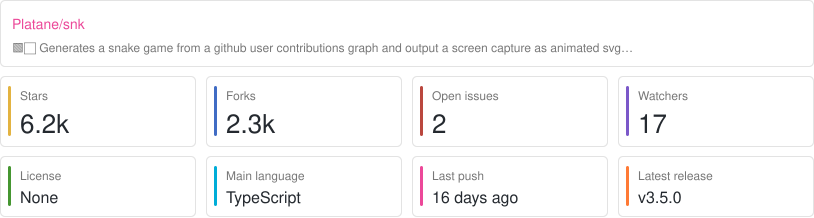
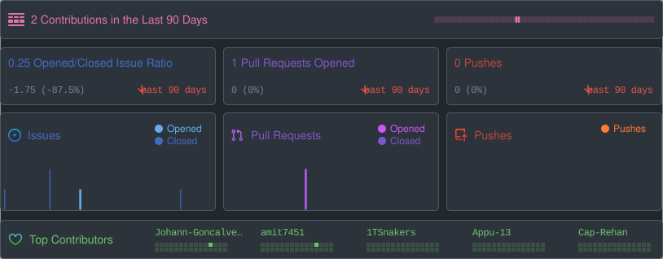
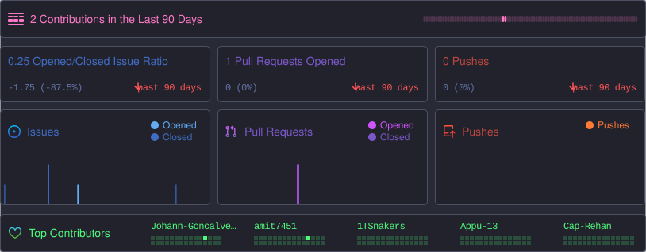
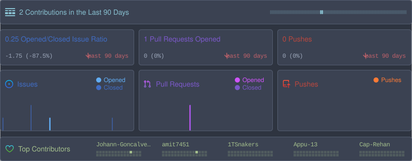
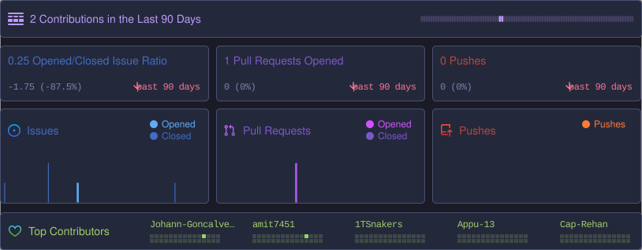

# Repobeats

GitHub repository cards (activity, languages, contributors, overview), generated as SVG files by a GitHub Action in your own workflow.

There is no sign-in, no GitHub App to install, no hosted service and no database. The Action runs on your runner as a prebuilt Docker image, reads the repository with a token you provide, and writes an SVG file. Your token and your repository data never go to a third party; the only network calls are to `api.github.com`.

The card shows pushes, opened and closed issues, opened and closed pull requests, the five most active contributors, and the change against the previous period of the same length.

## Examples

Generated weekly by [`showcase.yml`](.github/workflows/showcase.yml) and stored on the `output` branch.

**`card: activity`** pushes, issues, pull requests, top contributors, change against the previous period

<picture>
  <source media="(prefers-color-scheme: dark)" srcset="https://raw.githubusercontent.com/spatelpatidar/repobeats/output/activity-dark.svg">
  
</picture>

**`card: contributors`** ranked contributors with a bar per person



**`card: languages`** language breakdown by bytes of code

<picture>
  <source media="(prefers-color-scheme: dark)" srcset="https://raw.githubusercontent.com/spatelpatidar/repobeats/output/languages-dracula.svg">
  
</picture>

**`card: overview`** stars, forks, open issues, watchers, license, last push, latest release

<picture>
  <source media="(prefers-color-scheme: dark)" srcset="https://raw.githubusercontent.com/spatelpatidar/repobeats/output/overview-nord.svg">
  
</picture>

**Themes** (`theme:`), shown on the activity card









## Use it

Add a step to a workflow. It has the same shape as `lowlighter/metrics`:

```yaml
- uses: actions/checkout@v4

- name: Repobeats - respondo-grpc
  uses: spatelpatidar/repobeats@v0.4.0
  continue-on-error: true
  timeout-minutes: 10
  with:
    token: ${{ secrets.METRICS_TOKEN }}
    user: spatelpatidar
    repo: respondo-grpc
    card: activity
    theme: dracula
    filename: repobeats.respondo-grpc.svg
    output_action: none
```

`output_action: none` leaves the file in the workspace for later steps. `output_action: commit` commits and pushes it to the checked-out branch (the job needs `permissions: contents: write`). A complete workflow with a schedule is in [`examples/repobeats.yml`](examples/repobeats.yml).

Then embed the file:

```md

```

## Inputs

| Input | Default | Notes |
| --- | --- | --- |
| `token` | empty | See [Tokens](#tokens). |
| `user` | current repo owner | Only needed when `repo` is a bare name. |
| `repo` | current repository | `owner/name`, or a bare name together with `user`. |
| `card` | `activity` | `activity`, `languages`, `contributors`, `overview` or `graph`. |
| `theme` | `light` | `light`, `dark`, `github-dimmed`, `dracula`, `nord`, `tokyo-night`, `solarized-light`. |
| `colors` | empty | 4 or 5 hex codes. Replaces `theme`. See [Custom colors](#custom-colors). |
| `animate` | `true` | `false` writes a static card. See [Animation](#animation). |
| `size` | `medium` | Width: `small` (610px), `medium` (814px), `large` (1221px). Height follows the card. |
| `period` | `30` | `7`, `14`, `30`, `90`, `180` or `365` days. Used by `activity` and `contributors`. |
| `graph_options` | empty | Only for `card: graph`. A query string such as `days=31&area=true`. See [Contribution graph](#contribution-graph). |
| `filename` | `repobeats.svg` | Path relative to the workspace. Parent folders are created. |
| `max_pages` | `50` | API pages (100 items each) read per list. Raise it for very busy repositories. |
| `output_action` | `none` | `none` or `commit`. |
| `commit_message` | `chore: update repobeats card` | Used with `commit`. |

## Custom colors

`colors` takes 4 or 5 hex codes. The position in the list decides what each color is used for, and the list replaces `theme`.

| Index | Role | Used for |
| --- | --- | --- |
| `[0]` | background | Card background. `transparent` is allowed here only. Panel fill, borders and highlights are mixed from it. |
| `[1]` | primary | Titles, header icon and day strip, the Issues series, top contributor names, bars and heat cells, first overview tiles. |
| `[2]` | secondary | The Pull Requests series. |
| `[3]` | text | Values and labels. Muted text (deltas, subtitles) is this color mixed into the background. |
| `[4]` | tertiary, optional | The Pushes series. When omitted it is the primary color with its hue turned 120 degrees. |

```yaml
- uses: spatelpatidar/repobeats@v0.4.0
  with:
    repo: spatelpatidar/respondo-grpc
    colors: "0b1020,ff4d8d,4dd2ff,eef1ff,ffd166"   # bg, primary, secondary, text, tertiary
```

Accepted forms: `#rrggbb` or `#rgb`, with or without the `#`, separated by commas or spaces, or a JSON array. In a workflow file, leave out the `#` or quote the value, because YAML reads an unquoted `#` as the start of a comment.

Every generated SVG starts with a comment that records the mapping, so you can check which position ended up where:

```
<!-- repobeats colors: [0] background=#0b1020, [1] primary=#ff4d8d, [2] secondary=#4dd2ff, [3] text=#eef1ff, [4] tertiary=#ffd166 -->
```

Some colors stay fixed on purpose: the green and red of trend arrows (a light or dark variant is picked from your background), and the GitHub language colors on the `languages` card. An invalid list stops the run with a message naming the position, for example ``colors[1] (primary) is `#12345`: use #rgb or #rrggbb``.

## Animation

Cards animate by default, using CSS inside the SVG, so it works when the file is embedded with `` or `` and needs no JavaScript.

| Where | Effect |
| --- | --- |
| All cards | Panels rise and fade in one after another. |
| `activity` | Chart bars grow from the baseline in a left-to-right wave. Header day strip and contributor heat cells fade in. A ring pings around the header icon, and the trend arrows bob slowly. |
| `languages` | The stacked bar wipes in from the left, then the legend rows rise. |
| `contributors` | Rows rise in and each bar grows from the left. |
| `overview` | Tiles rise in one after another. |

Viewers who turn on "reduce motion" in their system settings see the finished card with no movement. `animate: false` removes the animation CSS from the file entirely.

## Cards

| Card | Shows | API requests |
| --- | --- | --- |
| `activity` | Contributions header, issue ratio, pull requests opened, pushes, issue/PR/push charts, top 5 contributors, change against the previous period. | Commits and issues, 730 days, paged. |
| `contributors` | Up to 10 contributors for the period, with a bar and share per person. | Same as `activity`. |
| `languages` | Stacked bar and legend of the 8 largest languages, the rest grouped as "Other". | 1 |
| `overview` | Stars, forks, open issues, watchers, license, main language, last push, latest release, description. | 2 |
| `graph` | Line graph of daily contributions over 1 to 365 days or a date range. See [Contribution graph](#contribution-graph). | Commits and issues, only as many days as the graph needs. |

`languages` and `overview` are cheap and work well without a token on a single public repository. `activity` and `contributors` read two years of history, so on busy repositories pass a token and raise `max_pages` if the step reports a pagination error.

## Contribution graph

`card: graph` draws a line graph of daily activity, in the style of [github-readme-activity-graph](https://github.com/Ashutosh00710/github-readme-activity-graph). One point is one day, counted as pushes + issues opened + pull requests opened (change it with `metric`). Unlike that project, which graphs a user's profile, this graphs one repository.

In a workflow, put the options in `graph_options` as a query string:

```yaml
- uses: spatelpatidar/repobeats@main
  with:
    card: graph
    repo: spatelpatidar/repobeats
    theme: dracula
    graph_options: days=31&area=true&line=ff79c6&point=ffb86c
    filename: graph.svg
```

Or serve it over HTTP and embed a URL, see [Graph server](#graph-server).

| Parameter | Default | Notes |
| --- | --- | --- |
| `days` | `31` | Whole number, 1 to 365. |
| `from`, `to` | | `YYYY-MM-DD`, inclusive, both required. Replace `days`. Must fall inside the last 365 days. |
| `metric` | `contributions` | `contributions`, `pushes`, `issues` or `pulls` (issues and pull requests are counted when opened). |
| `area` | `false` | Fill under the line. |
| `grid` | `true` | Grid lines. The zero line stays. |
| `smooth` | `true` | Curved line. `false` gives straight segments. |
| `hide_title` | `false` | Remove the title row. |
| `custom_title` | `owner/name Contribution Graph` | Up to 64 characters, longer is cut. |
| `hide_border` | `false` | No border. |
| `radius` | `0` | Corner radius, 0 to 16 (larger values are set to 16). |
| `height` | `318` | 200 to 600 (out-of-range values are clamped). The width follows `size`. |
| `bg_color` | theme | Hex code with or without `#`, or `transparent`. |
| `border_color`, `color`, `title_color`, `line`, `point`, `area_color` | theme | Hex codes. `color` is the text color. |

Booleans accept `true`/`false`, `on`/`off`, `yes`/`no`, `1`/`0`. Invalid values are an error, not silently ignored. Parameters this card does not know are ignored, so `&v=2` works as a cache buster.

The graph also takes the usual `theme`, `size` and `animate` options (on the server they are query parameters too). The `colors` list is not used by this card: use the per-part parameters above.

Names differ from github-readme-activity-graph where this project already had a convention: its `username` is `user` plus `repo` here, and `theme` names are this project's (`light`, `dark`, `github-dimmed`, `dracula`, `nord`, `tokyo-night`, `solarized-light`).

## Graph server

A small HTTP server returns the graph for a URL, and serves a page that builds the URL for you. It is optional and not part of the Action image.

```bash
GITHUB_TOKEN=ghp_xxx cargo run --release --features server --bin repobeats-server
# open http://localhost:5100
curl 'http://localhost:5100/graph?user=spatelpatidar&repo=repobeats&days=31&area=true&theme=dark'
```

Then embed it:

```md

```

| Route | Returns |
| --- | --- |
| `GET /` | The page: a form for every parameter, a live preview, and Markdown/HTML/URL to copy. |
| `GET /graph` | The SVG. Needs `repo` and `user` (or `repo=owner/name`), plus any [graph parameters](#contribution-graph), `theme`, `size` and `animate`. |
| `GET /healthz` | `ok`. |

Errors are also SVG cards, with a status code: `400` for a bad parameter, `404` unknown or private repository, `429` GitHub rate limit, `502` other GitHub failures. Successful responses are cached for 30 minutes (`Cache-Control: public, max-age=1800`).

Settings, all environment variables: `PORT` (5100), `REPOBEATS_TOKEN` or `GITHUB_TOKEN`, `GITHUB_API_URL`, `REPOBEATS_CACHE_SECONDS` (1800). Set a token: without one GitHub allows 60 requests an hour for the whole server, which a few visitors will use up. The token can read whatever it can access, and the server will draw any repository that token can see, so do not give a server a token with access to private repositories unless you want those graphs public. A `Dockerfile.server` is included.

## Tokens

| Case | Token |
| --- | --- |
| Public repository | None needed, but anonymous requests are limited to 60 per hour per IP address. Pass `secrets.GITHUB_TOKEN` to avoid that. |
| The repository running the workflow, public or private | `${{ secrets.GITHUB_TOKEN }}` is enough. |
| A different private repository | A personal access token stored as a repository secret. Fine-grained: read-only access to **Contents**, **Issues**, **Pull requests** and **Metadata** on that one repository. Classic: `repo` scope. |

The token is passed to the Action through an environment variable and only used for `GET` requests.

## What ends up in the SVG

Counts, the GitHub login (or commit author name) of the top contributors, and for `overview` the repository description, license and latest release tag. If the repository is private and you commit the SVG to a public repository, those details become public. Commit it to a private repository, or keep it as a workflow artifact, if that matters.

## Releases are automatic

The `version` in `Cargo.toml` decides what is released when a pull request is merged into `main`. There is one branch and no tags to make by hand.

| `version` in `Cargo.toml` | Release | Git tag | Docker image tags | GitHub Release |
| --- | --- | --- | --- | --- |
| `0.4.0-beta.1` | pre-release | `v0.4.0-beta.1` | `0.4.0-beta.1`, `v0.4.0-beta.1`, `beta` | marked **Pre-release** |
| `0.4.0` | stable | `v0.4.0` | `0.4.0`, `v0.4.0`, `v0`, `latest` | marked **Latest** |

A pre-release never moves `latest` or `v0`, so people on `@v0` only get stable releases. Other suffixes work too: `0.4.0-rc.1` is a pre-release with the image tag `rc`.

**Workflow**
1. Work on a feature branch. When you want to publish a beta, change the version to `0.4.0-beta.1` in `Cargo.toml` and update the lock file with `cargo build`. Commit both files.
2. Merge the pull request. A pre-release and a `beta` image are published. Try it with `uses: <owner>/repobeats@v0.4.0-beta.1`.
3. For more betas, raise the number (`0.4.0-beta.2`) in the next pull request.
4. To ship, open a pull request that sets the version to `0.4.0` (and updates `Cargo.lock`). When it merges, the stable release and the `latest` image are published.

If a merged pull request does not change the version, the tag already exists and nothing is released. Documentation and showcase changes do not run the workflow at all. Add `[skip release]` to a commit message to skip it on a code change.

**What each run does:** it runs `cargo fmt --check`, `clippy` and `cargo test --locked` (a failure stops the release, and `--locked` also fails when `Cargo.lock` does not match the version), builds and pushes the Docker image to `ghcr.io/<owner>/repobeats`, creates the tag (the tagged commit carries an `action.yml` pinned to that image, and no extra commit lands on `main`), and creates the GitHub Release with generated notes.

The version must look like `0.4.0` or `0.4.0-beta.1`. `0.4.0.beta` is not valid in Cargo. If a run fails after the version check, fix the problem and use **Actions, Release, Run workflow** to retry the same version.

One-time setup:
- After the first release, open the package on GitHub (your profile, Packages, `repobeats`, Package settings) and set visibility to **Public**. Workflows can only pull the image anonymously if it is public.
- If your organization restricts workflow permissions, allow **Read and write permissions** under Settings, Actions, General.

In your own workflows: `@v0` follows the newest stable `0.x`, `@v0.4.1` pins a stable release, and `@v0.5.0-beta.1` tries a beta.

If you use another owner or name, change the `image:` line in `action.yml` and the `uses:` lines in this README and the examples. See [CONTRIBUTING.md](CONTRIBUTING.md) for the pull request steps and [BUILD_AND_TEST.md](BUILD_AND_TEST.md) if you are new to Rust.

## Run it locally

```bash
cargo build --release
GITHUB_TOKEN=ghp_xxx ./target/release/repobeats --repo owner/name --card languages --theme nord --filename card.svg

# custom colors: background, primary, secondary, text, tertiary (optional)
./target/release/repobeats --repo owner/name --colors "#0b1020,#ff4d8d,#4dd2ff,#eef1ff,#ffd166"
```

Every option is also available as a `REPOBEATS_<NAME>` environment variable (`REPOBEATS_REPO`, `REPOBEATS_CARD`, `REPOBEATS_PERIOD`, ...). `GITHUB_API_URL` is honored, so GitHub Enterprise Server works.

## How it works

- `src/collector.rs` reads commits and issues/pull requests for the last 730 days (two full 365-day windows, so any period can be compared with the one before it), plus languages, repository details and the latest release.
- `src/model.rs` buckets activity per day, ranks contributors and parses repository details.
- `src/card/colors.rs` parses the `colors` list and derives the extra shades.
- `src/card/render.rs` draws the activity card and holds the themes and the animation CSS. `src/card/render/extra.rs` draws the languages, contributors and overview cards.
- `src/card/graph_options.rs` parses the graph parameters and `src/card/render/graph.rs` draws the graph. `src/params.rs` holds the parsing helpers shared with the server.
- `src/main.rs` is the command line the Action calls. `src/server.rs` and `web/index.html` are the optional server and its page (`--features server`).

## Development

```bash
cargo fmt --check
cargo clippy --all-targets -- -D warnings
cargo clippy --all-targets --features server -- -D warnings
cargo test
```

## Changes from the hosted version

The original project was a web service with GitHub OAuth sign-in, a GitHub App with admin verification, a database and a cache. All of that is removed. The activity card renderer and the activity model are unchanged apart from new themes.

## License

MIT. This project is a clean-room implementation and is not affiliated with Axiom.
